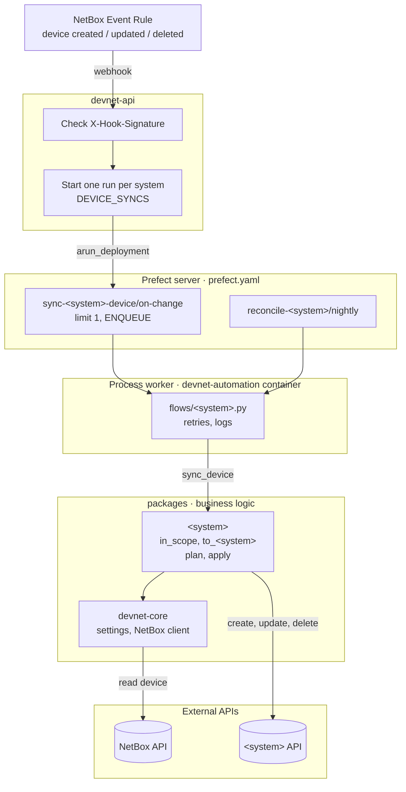

# Architecture

How a change in NetBox reaches the systems devnet keeps in sync with it.

## Components

| Part                    | Responsible for                                                                                                                     | Not responsible for                                         |
| ----------------------- | ----------------------------------------------------------------------------------------------------------------------------------- | ----------------------------------------------------------- |
| NetBox                  | Source of truth. An Event Rule sends a webhook when a device is created, updated or deleted                                         | Deciding which devices belong in which system               |
| devnet-api              | Checks `X-Hook-Signature`, starts one run per system in `DEVICE_SYNCS`, returns 202 with the run IDs                                | Calling a system's API, business rules, waiting for results |
| Prefect server + worker | Queueing (one sync per system at a time), retries, logs, run history, nightly reconcile                                             | Business rules                                              |
| `packages/<system>/`    | Which devices belong in the system, mapping NetBox fields to the system's, comparing, create/update/delete through the system's API | Webhooks, scheduling                                        |
| `devnet-core`           | Settings base, NetBox client, shared errors                                                                                         | Anything specific to one system                             |

- **Redelivered webhooks don't start new runs.** The idempotency key is built from NetBox's `request_id`,
- **When devnet creates a device in a system, it stores the NetBox device ID on it**, so the sync can still find it after the device is deleted from NetBox.
