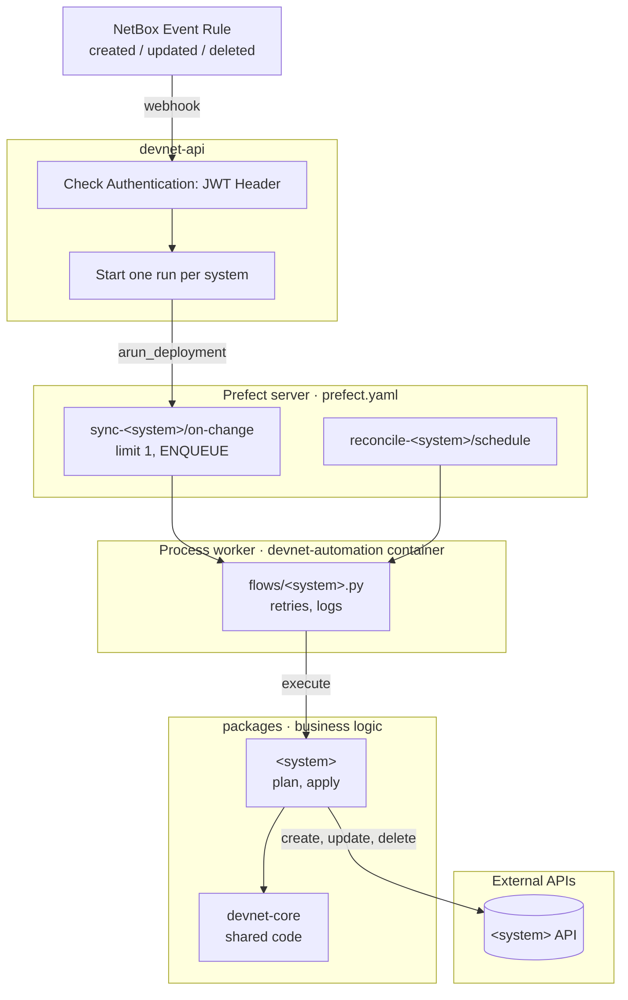

# Architecture

## System Overview

## Components

| Part                    | Responsible for                                                                                                                     | Not responsible for                                         |
| ----------------------- | ----------------------------------------------------------------------------------------------------------------------------------- | ----------------------------------------------------------- |
| NetBox                  | Source of truth. An Event Rule sends a webhook when a something is created, updated or deleted                                      | Deciding which devices belong in which system               |
| devnet-api              | Checks `Authorization` header, starts one run per system, returns 202 with the run IDs                                              | Calling a system's API, business rules, waiting for results |
| Prefect server + worker | Queueing (one sync per system at a time), retries, logs, run history, nightly reconcile                                             | Business rules                                              |
| `packages/<system>/`    | Which devices belong in the system, mapping NetBox fields to the system's, comparing, create/update/delete through the system's API | Webhooks, scheduling                                        |
| `packages/devnet-core`  | Settings base, shared logic                                                                                                         | Anything specific to one system                             |

## Design Principles

- **When devnet creates a device in a system, it stores the NetBox device ID on it**, so the sync can still find it after the device is deleted from NetBox
- **Each service provisions what it depends on**: devnet-flows its Prefect concurrency limits, devnet-api the NetBox webhook and event rule that call it
