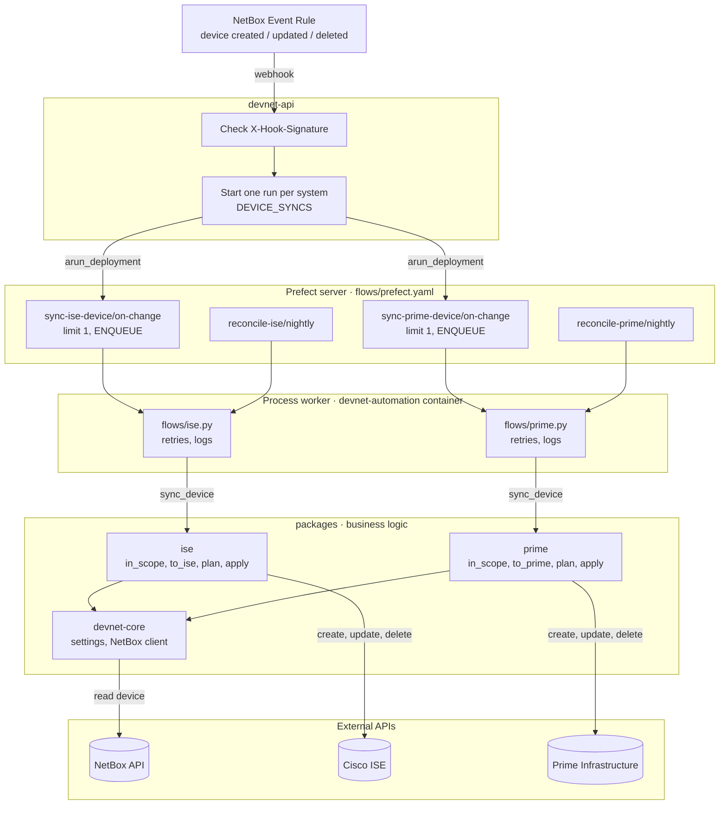
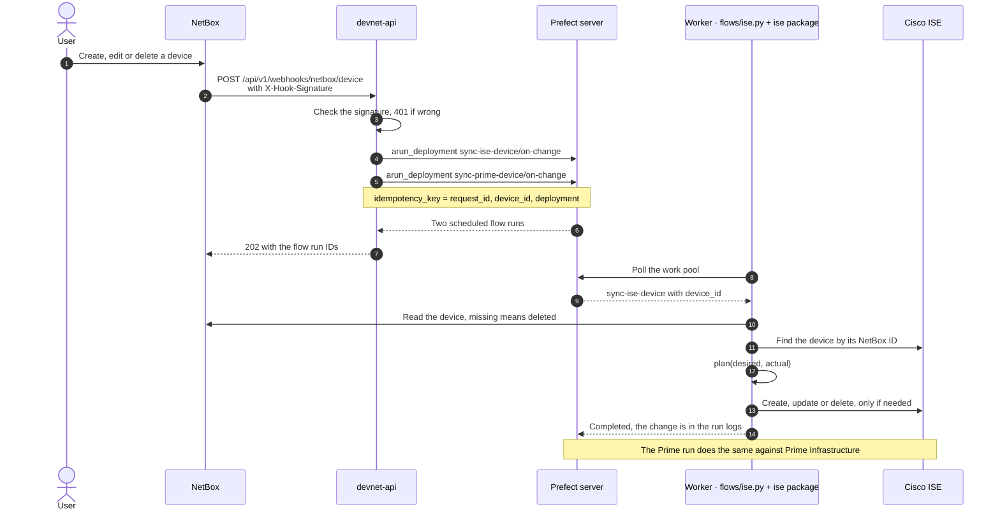
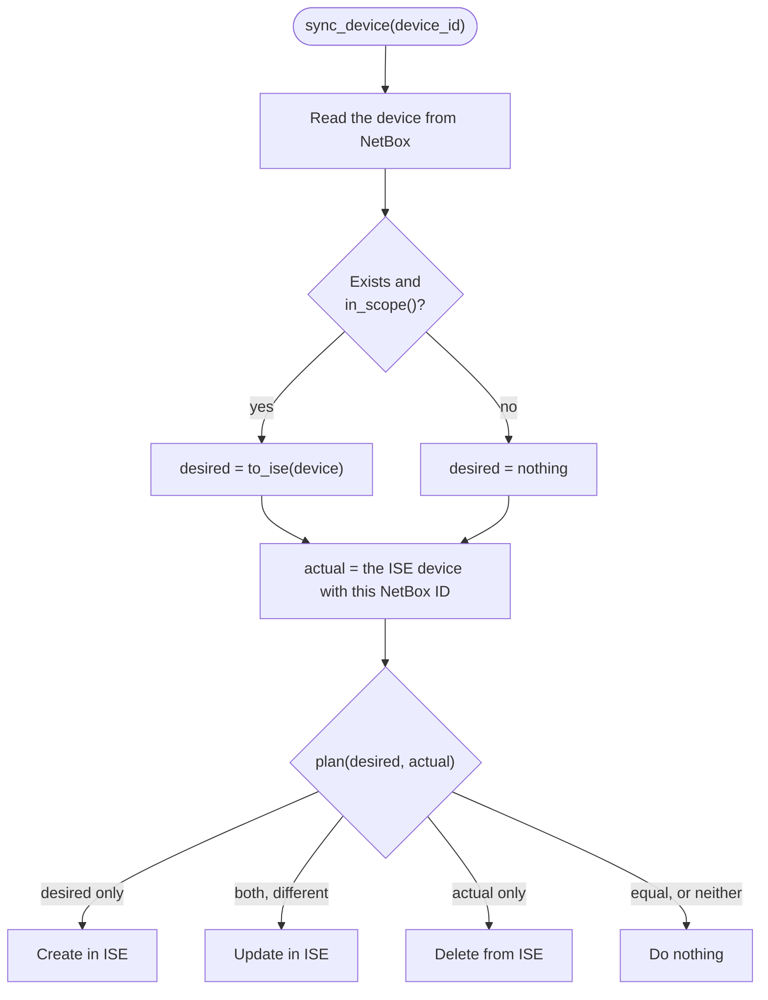

# Architecture

How a change in NetBox reaches Cisco ISE and Prime Infrastructure.

## Components

| Part | Responsible for | Not responsible for |
| --- | --- | --- |
| NetBox | Source of truth. An Event Rule sends a webhook when a device is created, updated or deleted | Deciding which devices belong in ISE or Prime |
| devnet-api | Checks `X-Hook-Signature`, starts one run per system in `DEVICE_SYNCS`, returns 202 with the run IDs | Calling ISE or Prime, business rules, waiting for results |
| Prefect server + worker | Queueing (one sync per system at a time), retries, logs, run history, nightly reconcile | Business rules |
| [flows/](../flows/) | Calling the package's `sync_device()` and logging what changed | Mapping or comparing |
| `ise` and `prime` packages | Which devices belong in the system, mapping NetBox fields to the system's, comparing, create/update/delete through the system's API | Webhooks, scheduling |
| `devnet-core` | Settings base, NetBox client, shared errors | Anything specific to one system |

## When a device changes

- **Redelivered webhooks don't start new runs.** The idempotency key is built from NetBox's `request_id`, the device ID and the deployment name, so the same webhook maps to the same runs. The device ID is part of the key because a bulk edit sends one webhook per device, all with the same `request_id`.
- **If Prefect can't be reached, the request fails with a 500**, so NetBox records a failed delivery instead of a 202 with no run behind it.

## How a sync decides what to do

- **The sync ignores the webhook's created/updated/deleted.** It compares NetBox with ISE every time, so a retry is safe and the order webhooks arrive in doesn't matter.
- **`reconcile-ise` runs the same `sync_device()` every night**, for every NetBox device and every ISE device that devnet manages. It repairs webhooks that were lost (NetBox doesn't resend a failed one unless `RQ_RETRY_MAX` is set) and manual changes made in ISE.
- **Which devices belong in ISE is decided by `in_scope()`, not by Event Rule conditions.** Conditions are checked against the device after the change, so a condition like "has tag ise" never fires for the edit that removes the tag, and the device would stay in ISE.
- **The NetBox device ID is stored on the ISE object when it's created**, so the sync can still find it after the device is deleted from NetBox.

## Adding another system

1. Create `packages/<system>/` with `settings.py`, `client.py`, `mapping.py` (`in_scope`, `to_<system>`) and `sync.py` (`sync_device`, `devices_to_check`).
2. Add `flows/<system>.py` with a `sync_<system>_device` flow and a `reconcile_<system>` flow.
3. Add two deployments to [flows/prefect.yaml](../flows/prefect.yaml): `on-change` with limit 1 and `ENQUEUE`, and `nightly` with a schedule.
4. Add `sync-<system>-device/on-change` to `DEVICE_SYNCS` in [routes/netbox.py](../services/devnet-api/src/devnet_api/routes/netbox.py).
