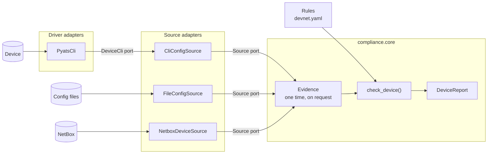

# Plan: Compliance Framework

- Status: Draft
- Date: 2026-11-10
- Decision: [0003. Compliance Rules Behind Ports And Adapters](../decisions/0003-compliance-rules-behind-ports-and-adapters.md)
- Prototype: [packages/\_compliance](../../packages/_compliance/)

## Goal

One way to write a check that reads a system and reports what is not compliant.

The old project checks the running config of Cisco devices only. The new framework also checks NetBox data. A new system adds a module and does not change the core.

The driver for network devices can change. pyATS is one adapter behind a port.

## Old Design

Source: `devnet_/_legacy/src/compliance_pipelines` and `network_shared`.

```text
flow: NetBox devices (Redis claim, 24 hours) -> one task for each device
  extract    pyATS session, show running-config    -> text
  evaluate   for each rule: scope, check(text)     -> ComplianceReport
  report     ComplianceRun -> markdown -> HTML     -> mail
```

### Keep

- A rule has a name, a scope and a `check` that returns findings
- Scope by platform, role, site and tags
- One report for each device. A rule that raises does not stop the other rules
- `ComplianceRun` with a markdown report for the mail
- One task for each device, and the Redis claim for device batches

### Problems

| Problem                                                                | Effect                                                                                       |
| ---------------------------------------------------------------------- | -------------------------------------------------------------------------------------------- |
| The engine takes one input: `evaluate(config_text, device, ...)`       | A rule for NetBox data, or for a second system, has no place                                 |
| The task, the rule and the flow import pyATS, ciscoconfparse2, Prefect | A different driver changes each layer. A rule cannot run in a test without Prefect           |
| Rules are Python objects in the flow module: `RULES = [...]`           | A new rule or a new scope is a code change and a deploy                                      |
| Each rule parses the config again                                      | With 30 rules, the same text is parsed 30 times                                              |
| A device problem is an exception                                       | A device without a primary IP fails the flow run. An unreachable device is not in the report |
| ciscoconfparse2 is the parser                                          | GPL-3.0 license. 13 dependencies, 9 of them with one exact version                           |

Defects found in the old code. The port must not copy them:

- **A read-only run changes the device config.** `device.connect()` uses the defaults of unicon. unicon then enters config mode at each connect and sends `no logging console`, `line console 0`, `exec-timeout 0`, `line vty 0 4`, `exec-timeout 0`. Measured with unicon 26.10 and its mock device. A device accepts these commands if the account can configure. The ingest flows use the same session code
- **Each session writes the config to `/tmp`.** unicon writes a log of each session to `/tmp/<device>-cli-<time>.log`. The file has the output of `show running-config`, and each user of the host can read it (mode `rw-rw-rw-`)
- Each disconnect waits 10 seconds (unicon default `POST_DISCONNECT_WAIT_SEC`). pyATS is blocking code, so the event loop of the worker stops for that time
- An unreachable device raises `SkipTaskError`, and `gather_results` drops it. The device is not in the report. The Redis claim then keeps it out of the runs of the next 24 hours
- `VrfHasImportMap` tests `"import map MNG" in line`, so `import map MNG-OLD` passes. It looks at the first VRF section only
- A VRF that is not defined counts as `passed`
- The rules are created when the module is imported, outside a flow run. `Rule.log` then does not write to the Prefect run log

## New Design



### Parts

| Part          | Code                                                | Responsible for                                                         |
| ------------- | --------------------------------------------------- | ----------------------------------------------------------------------- |
| Device        | `Device`                                            | The object that a run checks: name, and the NetBox fields for the scope |
| Data kind     | A class, e.g. `RunningConfig`, `NetboxDeviceRecord` | One kind of data about one device                                       |
| Source        | Port `Source`: `provides`, `collect(device)`        | Reads one data kind from one system                                     |
| Device driver | Port `DeviceCli`: `run(target, commands)`           | Runs show commands on a device                                          |
| Rule kind     | `Rule` subclass: `kind`, parameters, `check()`      | One check. It asks for the data that it needs                           |
| Engine        | `check_device()`                                    | Scope, run each rule, outcomes, report. The same for each system        |
| Config        | `ComplianceConfig`                                  | The rules in `devnet.yaml`                                              |
| Flow          | devnet-flows                                        | Inventory, one task for each device, builds the adapters, mail          |

The core (`compliance.core`) is 430 lines. A system is a folder with its data kinds, its sources and its rule kinds.

### Rules

1. **The core knows no system.** `compliance.core` imports no client, no parser and no driver. An import contract checks this
2. **A rule asks for data by class.** `config = await evidence.get(RunningConfig)`. The rule does not know if the config comes from the device or from a file
3. **Data is collected on request, one time for each device.** If no rule in scope asks for the running config, no session to the device opens. 30 rules use one session and one parse
4. **A source returns complete data or raises.** The rules that need the data get the outcome `error`. The other rules run
5. **A rule is an entry in the config file.** `kind` selects the class. The other fields are its parameters. A bad parameter, such as a pattern that is not a regular expression, fails when the config loads
6. **A rule returns findings and does not raise for them.** `NotApplicable` is for a device without the thing that the rule checks. Each other exception is a defect of the rule: outcome `error`
7. **A library stays behind a devnet class.** Only `PyatsCli` imports pyATS. Only `ConfigTree` uses the netutils parser. Rules use `ConfigTree`
8. **Compliance does not write.** A session to a device does not enter config mode

### Outcomes

| Outcome   | Cause                                                                     | Device is compliant |
| --------- | ------------------------------------------------------------------------- | ------------------- |
| `passed`  | The rule returned no finding                                              | Yes                 |
| `failed`  | The rule returned findings                                                | No                  |
| `skipped` | The device is out of scope, or the rule raised `NotApplicable`            | Yes                 |
| `error`   | The data could not be collected, or the rule raised a different exception | No: not known       |

### Config File

```yaml
compliance:
  rules:
    - name: mng-vrf-import-map
      kind: vrf_has_import_map
      vrf: mng
      map_name: MNG
      scope:
        roles: [wan-core-router, wan-router]

    - name: vty-ssh-only
      kind: config_must_contain
      severity: error
      section: ^line vty
      lines:
        - transport input ssh
      scope:
        platforms: [ios, iosxe]

    - name: no-http-server
      kind: config_must_not_match
      severity: critical
      pattern: ^ip http server$

    - name: netbox-required-fields
      kind: netbox_must_have
      fields: [primary_ip4, serial, tenant]

    - name: ntp-servers
      kind: config_must_contain_netbox
      netbox_field: config_context.ntp_servers
      line: ntp server {value}
```

| Kind                         | System         | Check                                                          |
| ---------------------------- | -------------- | -------------------------------------------------------------- |
| `config_must_contain`        | Cisco config   | Each line is in the config, or below each section that matches |
| `config_must_not_match`      | Cisco config   | No line matches the pattern                                    |
| `vrf_has_import_map`         | Cisco config   | The rule of the old project                                    |
| `netbox_must_have`           | NetBox         | The device has a value for each field                          |
| `config_must_contain_netbox` | Config, NetBox | The config has one line for each value of a NetBox field       |

### Report

`check_device()` returns a `DeviceReport`: one `RuleResult` for each rule, with the outcome, the findings and the reason for a skip or an error. `ComplianceRun.to_markdown()` is the body of the mail. This is the output of the rules above for three devices. The third device has no config:

```text
# Compliance report

**3** devices checked: **1** with findings (**4** findings), **1** not fully checked.

## Findings

| Device  | Severity | Rule                   | Message                                     | Config         |
| ------- | -------- | ---------------------- | ------------------------------------------- | -------------- |
| wan-rt1 | critical | no-http-server         | lines that match ^ip http server$: 1        | ip http server |
| wan-rt1 | error    | vty-ssh-only           | line vty 5 15: missing: transport input ssh | line vty 5 15  |
| wan-rt1 | warning  | netbox-required-fields | NetBox has no value for: tenant             |                |
| wan-rt1 | warning  | ntp-servers            | missing: ntp server 10.0.0.11               |                |

## Not Checked

| Device | Reason                                             |
| ------ | -------------------------------------------------- |
| dc-sw2 | RunningConfig: no config file dc-sw2.cfg (2 rules) |
```

## Ports And Adapters

| Port        | Contract                                                         | Adapters in the prototype                                   | Later                  |
| ----------- | ---------------------------------------------------------------- | ----------------------------------------------------------- | ---------------------- |
| `Source`    | `collect(device)` returns one data kind, or raises               | `CliConfigSource`, `FileConfigSource`, `NetboxDeviceSource` | ISE, NSX, device state |
| `DeviceCli` | `run(target, commands)`: one session, the output of each command | `PyatsCli`                                                  | scrapli, netmiko       |

A port is a `typing.Protocol`. An adapter is a class with the same members. It does not subclass the port.

`Source` makes the core independent of the systems. `DeviceCli` makes the code independent of the driver: `CliConfigSource` takes a `DeviceCli` and does not know which one. The ingest collector needs the same `DeviceCli`.

The flow selects the adapters. This is the only code that names them:

```python
sources: list[AnySource] = [
    CliConfigSource(PyatsCli(username=..., password=...)),
    NetboxDeviceSource(netbox_client),
]
report = await check_device(device, config.compliance.rules, sources)
```

With `FileConfigSource(Path("/backups"))` in place of `CliConfigSource`, the same rules run on config backups, without a session.

### Network OS Names

Each library has its own names for a network OS. devnet uses the names of netutils (the same as netmiko): `cisco_ios`, `cisco_xe`, `cisco_xr`, `cisco_nxos`, `cisco_asa`. `compliance.device.platform` maps a NetBox platform slug to this name. An adapter gets the name of its library from `netutils.lib_mapper`: pyATS `iosxe`, scrapli `cisco_iosxe`.

### pyATS Adapter

`PyatsCli` is the session code of the old project, with these changes:

- pyATS is blocking code. The adapter runs it in a worker thread
- `init_config_commands=[]`: the session does not enter config mode
- `log_buffer=True`: no session log in `/tmp`
- `POST_DISCONNECT_WAIT_SEC: 0`: no wait of 10 seconds after the disconnect
- An error of unicon becomes `SystemConnectionError`, the same exception as for NetBox

The tests run the adapter against the mock device of unicon.

One risk stays. unicon starts `ssh` with a fork. Python 3.13 warns that a fork in a process with threads can deadlock. A driver that has SSH in Python (asyncssh) does not fork.

## Compliance Or Sync

Compliance and the [ingest framework](ingest-framework.md) both compare. Use this rule:

| Question                                                           | Tool                                               |
| ------------------------------------------------------------------ | -------------------------------------------------- |
| Is a fact true for this device? "No HTTP server", "tenant is set"  | A compliance rule                                  |
| Do two systems have the same objects? Interfaces, addresses, VLANs | A sync with `dry_run=True`. The diff is the report |

Do not write a compliance rule that compares lists of objects from two systems. That is a DiffSync diff.

## Old To New

| Old                                                        | New                                                                                           |
| ---------------------------------------------------------- | --------------------------------------------------------------------------------------------- |
| `Rule` (ABC), `name` as a class attribute                  | `Rule` (config model). `kind` is the class. `name` is the rule in the config file             |
| `Scope`, `Rule.applies_to()`                               | `Scope`, same fields, in the config file. `NotApplicable` for a condition that needs the data |
| `ConfigContext(device, text)`                              | `await evidence.get(RunningConfig)`                                                           |
| `get_config_parser()` (ciscoconfparse2)                    | `RunningConfig.tree`: a `ConfigTree` (netutils parser), parsed one time                       |
| `Finding`, `Severity`                                      | No change. `rule.finding()` sets the rule name and the severity. Severity is a rule parameter |
| `evaluate()`                                               | `check_device()`                                                                              |
| `ComplianceReport` counters, `rule_errors`                 | `DeviceReport.results`: one `RuleResult` for each rule. `DeviceReport.errors`                 |
| `ComplianceRun.to_markdown()`                              | Same purpose. New section "Not Checked". The most severe findings first                       |
| `ComplianceRun.to_html()`, `send_email_report()`           | devnet-flows                                                                                  |
| `VrfHasImportMap`                                          | Rule kind `vrf_has_import_map`                                                                |
| `RULES` in the flow module                                 | `compliance.rules` in `devnet.yaml`                                                           |
| `extract_cisco_running_config` task                        | `CliConfigSource` with a `DeviceCli`                                                          |
| `collect_from_device()`, `get_device_session()`, `Testbed` | `PyatsCli`                                                                                    |
| `is_port_open()`, `LEGACY_SSH_OPTIONS`                     | In `PyatsCli`                                                                                 |
| `DeviceTarget`, `DeviceConfig`                             | `CliTarget`                                                                                   |
| `DeviceOSEnum`, `PLATFORM_TO_OS`, `CCP_SYNTAX`             | `compliance.device.platform.PLATFORMS`, `netutils.lib_mapper`                                 |
| `DeviceCredentials` Prefect block                          | Arguments of the adapter. The flow reads them from the secrets of `devnet.yaml`               |
| `skip_on(ConnectionTimeoutError)`                          | Outcome `error`. The device is in "Not Checked"                                               |
| `device_chunk_generator` (Redis claim)                     | No change. It moves to devnet-flows, the same as for ingest                                   |

## Package Layout

| Path                            | Contents                                                                                                      |
| ------------------------------- | ------------------------------------------------------------------------------------------------------------- |
| `packages/system-devices` (new) | `DeviceCli`, `CliTarget`, network OS names. One module for each driver. A driver is an optional dependency    |
| `packages/compliance`           | `core`, one folder for each system (`cisco`, `netbox`), `intent` (rules that use two systems), `config`       |
| `packages/system-netbox`        | New endpoint `client.dcim.devices`                                                                            |
| `packages/devnet-config`        | `compliance: ComplianceConfig` in `DevnetConfig`. Device credentials and the driver name in `systems.devices` |
| `services/devnet-flows`         | Flow `compliance`: inventory, one task for each device, builds the adapters, mail                             |

The import layers are those of the ingest plan. Inside `compliance`, these contracts hold for the prototype. They need `include_external_packages = true`. After the promotion, `compliance.device` is `system_devices`:

```toml
[[tool.importlinter.contracts]]
name = "Compliance: the core knows no system and no driver"
type = "layers"
layers = [
    "compliance.config",
    "compliance.intent",
    "compliance.cisco | compliance.netbox",
    "compliance.core | compliance.device",
]

[[tool.importlinter.contracts]]
name = "Compliance: the core imports no client and no parser"
type = "forbidden"
source_modules = ["compliance.core"]
forbidden_modules = ["system_netbox", "netutils", "httpx2"]

[[tool.importlinter.contracts]]
name = "Compliance: only the pyATS adapter imports pyATS"
type = "forbidden"
source_modules = ["compliance"]
forbidden_modules = ["pyats", "genie", "unicon"]
ignore_imports = ["compliance.device.pyats_cli -> genie", "compliance.device.pyats_cli -> unicon"]
```

## Add A Feature

**A rule of a known kind.** Add an entry to `compliance.rules`. No code.

**A rule kind.**

1. In the folder of the system, write a `Rule` subclass. `kind: Literal["..."]` and the parameters are fields
2. Write `check()`. Ask for data with `await evidence.get(...)`. Return `self.finding(...)` for each problem
3. Add the class to `AnyRule` in `compliance/config.py`
4. Test the rule with a sample of the data

**A system**, e.g. ISE.

1. Write a class for each data kind
2. Write a source: a class with `provides` and `collect(device)`. It uses the client of the system
3. Write the rule kinds
4. Add the source to the list in the flow

**A device driver**, e.g. scrapli.

1. Write a class with `async def run(target, commands) -> list[str]`. Raise `SystemConnectionError` for each failure
2. Run the tests of `PyatsCli` against the new class
3. Select the class in the flow

The smallest complete feature is at the top of [test_engine.py](../../packages/_compliance/tests/test_engine.py): one data kind, one source and one rule in 35 lines.

## Prototype

| File                             | Contents                                                       |
| -------------------------------- | -------------------------------------------------------------- |
| `compliance/core/models.py`      | `Device`, `Finding`, `Severity`, `Outcome`                     |
| `compliance/core/evidence.py`    | `Source` port, `Evidence`: collect on request, one time        |
| `compliance/core/rule.py`        | `Rule`, `Scope`, `NotApplicable`, `Regex`                      |
| `compliance/core/engine.py`      | `check_device()`                                               |
| `compliance/core/report.py`      | `RuleResult`, `DeviceReport`, `ComplianceRun`                  |
| `compliance/device/cli.py`       | `DeviceCli` port, `CliTarget`                                  |
| `compliance/device/platform.py`  | NetBox platform slug to network OS name                        |
| `compliance/device/pyats_cli.py` | `PyatsCli`                                                     |
| `compliance/cisco/`              | `RunningConfig`, `ConfigTree`, two sources, three rule kinds   |
| `compliance/netbox/`             | `NetboxDeviceRecord`, `NetboxDeviceSource`, `netbox_must_have` |
| `compliance/intent.py`           | `config_must_contain_netbox`                                   |
| `compliance/config.py`           | `ComplianceConfig`, `AnyRule`                                  |
| `tests/mock_iosxe/device.yaml`   | A device for the mock of unicon                                |

```bash
uv run --package compliance pytest packages/_compliance/tests
```

Limits of the prototype:

- No run against a real device or a real NetBox. The NetBox tests use the real `NetboxClient` with a fake transport
- pyATS is not in `uv.lock`, so the workspace skips the tests that open a pyATS session. They passed in a separate environment: Python 3.13, pyATS 26.10, the mock device of unicon
- No flow, no inventory and no mail
- The object that a run checks is a device. Rules for other objects, such as prefixes, are not designed
- `NetboxDeviceSource` reads the device record only: no interfaces, no addresses
- `FileConfigSource` does not check the age of a file
- `vrf_has_import_map` knows the VRF syntax of IOS, IOS XE and NX-OS, as the old rule. It does not know IOS XR

## Steps

1. Answer the open questions. Accept ADR 0003
2. Look at the devices for `exec-timeout 0` on `line vty 0 4` and for `no logging console`. The old flows can be the cause. Remove the `*-cli-*.log` files from `/tmp` of the old worker
3. Run `check_device()` with `PyatsCli` against the dev NetBox and one lab device
4. Promote the prototype: rename `_compliance` to `compliance`, move `compliance.device` to `system-devices`, add the endpoint to `system_netbox`, add `compliance` to `DevnetConfig`, add the import contracts and deptry
5. Flow `compliance`: inventory, Redis claim, one task for each device, mail from `ComplianceRun.to_markdown()`
6. Move the production rules to `devnet.yaml`
7. Second driver: a scrapli adapter, with the tests of `PyatsCli`
8. More data kinds: NetBox interfaces, device state, ISE

## Open Questions

1. **What a NetBox rule checks.** The prototype has two readings. `netbox_must_have` checks the NetBox data of the device. `config_must_contain_netbox` uses NetBox values as the intended config. Rules for objects that are not devices (prefix, VLAN, site) need a second kind of checked object. Is that necessary?
2. **Secrets in the report.** A finding shows config lines, and the report is a mail. A rule such as "no `enable password`" then mails the line with the secret. Options: a `show_lines: false` parameter on a rule, or a sanitise step for all findings
3. **Unreachable devices.** The report now has them in "Not Checked". The Redis claim still keeps them out for 24 hours. Release the claim of a device that was not checked?
4. **Where the rules are.** The prototype reads them from `devnet.yaml`. With many rules, a file for the rules only is easier to review
5. **Second driver.** The port is ready. Which driver, and when?
6. **Names.** `system-devices`, the names of the rule kinds, and the data kind in an error (`RunningConfig: ...`) are proposals
