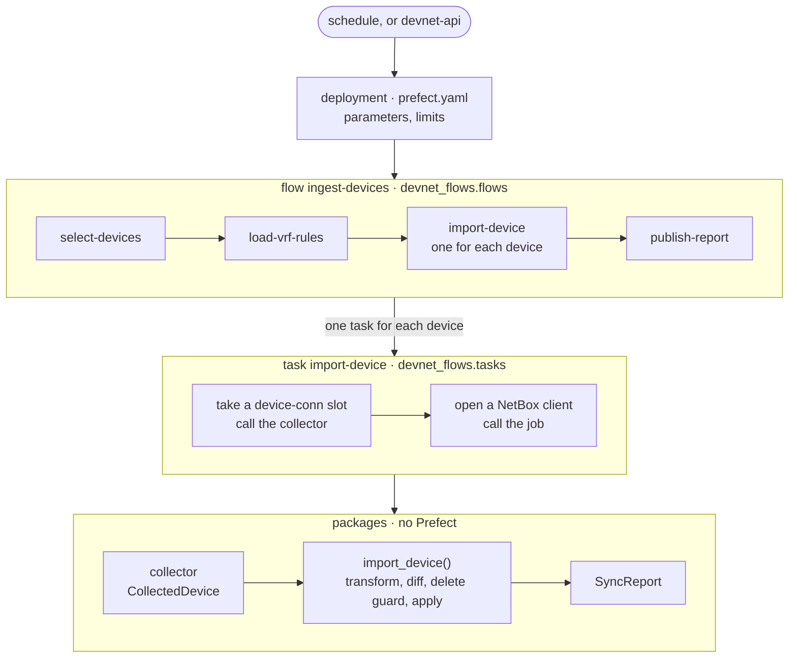

# Plan: Flows Architecture

- Status: Draft
- Date: 2026-11-19
- Code: [services/devnet-flows](../../services/devnet-flows/)
- Related: [Architecture](../ARCHITECTURE.md), [Ingest Framework](ingest-framework.md), [0002. DiffSync For Reconciliation](../decisions/0002-diffsync-for-reconciliation.md)

## Goal

One way to write a flow. A flow chooses the objects of a run, runs one task for each object and reports what happened. The logic stays in the packages, and the packages don't know Prefect.

This plan says where each kind of code goes: logic, transforms, tasks, flows and deployments.

## Old Design

Source: `devnet_/_legacy/src/netbox_pipelines/flows`, `compliance_pipelines/flows` and `network_shared/prefect`.

```text
flow: device_chunk_generator (NetBox devices, Redis claim) -> process_device.map(devices)
  process_device   extract_*.fn(target)     pyATS session, Genie parsers
                   update_*.fn(request)     pynetbox, reconcile
  gather_results   drops SkipTaskError
  report           SyncRun / ComplianceRun -> HTML -> mail, then RuntimeError if a task failed
```

### Keep

- One task for each device. A failure stays in that device
- The `device-conn` limit on device sessions, across all runs. devnet-flows provisions it
- One mail with the report, only if a person must look at something
- A mail when a run fails

### Problems

| Problem                                                                                                                                            | Effect                                                                                                  |
| -------------------------------------------------------------------------------------------------------------------------------------------------- | ------------------------------------------------------------------------------------------------------- |
| A task calls other tasks with `.fn`, e.g. `await extract_cisco_facts_only.fn(target)`                                                              | Their retries and timeouts don't apply. A comment in the flows says so                                  |
| Four flows repeat the fan-out, `gather_results`, the run report, the mail and the `RuntimeError`                                                   | A new flow starts as a copy                                                                             |
| `skip_on(ConnectionTimeoutError)` raises `SkipTaskError`, and `gather_results` drops it                                                            | An unreachable device is in no report. Its claim keeps it out of the next runs until the TTL ends       |
| Settings in Prefect blocks and variables: `NetboxServer`, `DeviceCredentials`, `RedisServer`, `NsxServer`, `email-notify`, the VM transform config | Two places for settings. A missing block fails at run time. The CLI and the tests need a Prefect server |
| `by_env()` and `is_dev_env()`: claim TTL, log level, no mail in dev                                                                                | Dev and prod run different code                                                                         |
| The sync code gets the Prefect run logger as `logger=`. The VM transform calls `get_flow_logger()`                                                 | Domain code needs Prefect                                                                               |
| The `device-conn` tag holds a slot for the whole task                                                                                              | The NetBox writes hold a device slot too. The VM import holds one and opens no device session           |
| `process_device.map(devices)` on the default task runner                                                                                           | One thread for each device: Prefect's thread pool has no limit by default (3.9: `sys.maxsize`)          |
| The report mail, then `RuntimeError`, then `notify_failure`                                                                                        | A run with a failed device sends two mails                                                              |

## Now

`services/devnet-flows` on 2026-11-21:

- `flows/ise.py`, `tasks/ise.py`: the flow `sync-ise-device` and its task `sync-device-to-ise`, which calls `domain_ingest.ise.sync_device()`. `tests/test_ise_flow.py` runs them with a fake job
- `systems.py`: `netbox()` and `ise()`
- `inventory.py`, `report.py`, `notify.py`, `monitoring.py`: written, without tests. No task or committed flow uses them yet
- `_flows/`: `ise_flow.py`, which is all comments. The stubs of the other flows are deleted
- `cli.py`, `provision/`: all comments
- `prefect.yaml`: one deployment, `compliance/nightly`. Its entrypoint `devnet_flows.flows.compliance` does not exist, so a deploy fails. `pull: []`, because the image has the installed package
- `logging.yaml`: sends the `devnet` logger to the run log

## Layers

```text
prefect.yaml          when a flow runs, with which parameters and limits
devnet_flows.flows    the objects of a run, the order of the tasks, the report
devnet_flows.tasks    one job run for one object: clients, slot, timeout
packages              the logic: jobs, transforms, rules, adapters. No Prefect
systems               NetBox, ISE, network devices
```



### Where Code Goes

| The code                                                                 | Goes in                            | Example                                  |
| ------------------------------------------------------------------------ | ---------------------------------- | ---------------------------------------- |
| Decides what a system must contain: rules, field mapping, compare, apply | A job in the feature package       | `domain_ingest.device.import_device()`   |
| Changes collected data with reference data, before the compare           | A transform in the feature package | VRF names, `VrfResolver` (ingest step 5) |
| Talks to one system                                                      | The system package                 | `NetboxClient`, `PyatsCli`               |
| Must time out, wait for a slot or show as one line in the UI             | A task                             | `import-device`                          |
| Chooses the objects of a run, and what the run reports                   | A flow                             | `ingest-devices`                         |
| Says when a flow runs and with which parameters                          | A deployment in `prefect.yaml`     | `ingest-devices/schedule`                |
| Builds clients and adapters from devnet.yaml                             | `devnet_flows/systems.py`          | `systems.netbox()`                       |
| Mails the report                                                         | `devnet_flows/notify.py`           | `notify.mail_report()`                   |
| Sends the errors and the check-ins of a run to Sentry                    | `devnet_flows/monitoring.py`       | `@monitored`                             |
| Creates the Prefect and NetBox objects that the flows need               | `devnet_flows/provision`           | The `device-conn` limit                  |

A test for each piece of code: is it still needed if cron and the CLI run the jobs, without Prefect? Then it goes in a package. devnet-flows has only what exists because of Prefect.

## Rules

1. **devnet-flows has no logic.** It decides what runs, when, how many at the same time, and who is told. A decision about data is in a package. The packages don't import Prefect: an import contract checks it
2. **One task is one job run for one object.** One device, or one NSX manager: the scope of the job (ingest rule 7). The steps of the job (collect, transform, diff, apply) are function calls, not tasks. A task does not call another task
3. **A task passes data through.** It can call the collector, then the job, with the result of the collector. If it must look inside the data, that code is a transform or part of the job
4. **A task opens its own clients.** `.map()` runs each task in its own thread, with its own event loop, so tasks can't share a client. A task gets IDs, names and parameters, and opens a client with `async with systems.netbox() as netbox`. A client is never a task parameter
5. **The flow body talks to no system.** Each read and each write is in a task, with its own timeout and log. A flow passes the result of one task to the next. An import contract keeps the clients out of the flows
6. **No object disappears.** Each object of the run is in its report: the report of its job, or the error that stopped its task. There is no skip exception
7. **A flow does not call another flow.** Two flows share tasks. devnet-api starts the event flows, schedules start the batch flows
8. **A flow that writes has `dry_run: bool = True`.** Only a deployment sets `dry_run: false`. A run from the UI is a dry run unless a person changes it
9. **Settings come from devnet-config.** devnet.yaml and the environment, the same as for devnet-api and the CLI. No Prefect blocks, no Prefect variables, no `by_env()`. A difference between dev and prod is a setting or a deployment parameter

## Layout

```text
services/devnet-flows/
├── prefect.yaml            one deployment for each flow and trigger
├── logging.yaml
├── tests/
└── src/devnet_flows/
    ├── cli.py              devnet-flows provision
    ├── provision/          Prefect limits, NetBox custom fields: what the flows need
    ├── flows/              @flow only. One module for each feature
    │   ├── ingest.py       ingest-devices, ingest-device-facts
    │   ├── compliance.py   compliance
    │   ├── ise.py          sync-ise-device, reconcile-ise
    │   └── backups.py      backups
    ├── tasks/              @task only. One module for each package that the tasks call
    │   ├── ingest.py       import-device, import-device-facts, load-vrf-rules
    │   ├── compliance.py   check-device
    │   ├── ise.py          select-ise-devices, sync-device-to-ise
    │   ├── inventory.py    select-devices
    │   └── report.py       publish-report
    ├── systems.py          clients and adapters from devnet.yaml, limit names
    ├── inventory.py        DeviceQuery, InventoryDevice
    ├── report.py           RunReport: task states to summary, markdown and final state
    ├── notify.py           the report mail: SMTP, with the settings in devnet.yaml
    └── monitoring.py       @monitored: Sentry for each flow run, the cron monitor of a scheduled flow
```

A flow module and a task module have 20 to 60 lines each. A longer one has logic that belongs in a package.

## Tasks

A task runs one job of a package for one object. A task body can:

- open clients with `systems`, and take a slot
- call package functions in order, and pass the result of one to the next
- log the report

It does not branch on the data, loop over objects, build a payload or catch an error.

```python
# tasks/ingest.py. Sketch: the collector and the VRF rules come with ingest steps 4 and 5
from prefect import task
from prefect.cache_policies import NO_CACHE
from prefect.concurrency.asyncio import concurrency

import domain_ingest.device
from devnet_core.logging import get_logger
from devnet_core.sync import SyncReport
from devnet_flows import systems
from devnet_flows.inventory import InventoryDevice

logger = get_logger(__name__)


@task(
    name="import-device",
    task_run_name="import-device-{device.name}",
    timeout_seconds=300,
    cache_policy=NO_CACHE,
)
async def import_device(device: InventoryDevice, vrfs: domain_ingest.device.VrfRules, dry_run: bool) -> SyncReport:
    async with concurrency(systems.DEVICE_CONN, strict=True):
        collected = await domain_ingest.device.collect(systems.device_cli(), device.cli_target())
    async with systems.netbox() as netbox:
        report = await domain_ingest.device.import_device(
            netbox, device_id=device.id, device_name=device.name, collected=collected, vrfs=vrfs, dry_run=dry_run
        )
    if dry_run:
        logger.info(report.diff)
    return report
```

The task imports the module of the package, so a package call reads as one: `domain_ingest.device.import_device(...)`. `check-device` builds the compliance sources with `systems` and calls `check_device()`: `systems.py` is the only code that names an adapter class.

| Setting           | Value                                                                  | Why                                                                                                                           |
| ----------------- | ---------------------------------------------------------------------- | ----------------------------------------------------------------------------------------------------------------------------- |
| `name`            | `<verb>-<object>`, e.g. `import-device`                                | The name in the UI and in the logs                                                                                            |
| `task_run_name`   | `import-device-{device.name}`                                          | One line for each device in the UI                                                                                            |
| `timeout_seconds` | On each task, above its slowest normal run                             | A hung session must not keep a slot and a thread. A timeout stops the job at once, the write in progress too                  |
| `cache_policy`    | `NO_CACHE`                                                             | A read or a write is true only when it runs. A cached report hides a run that did not happen                                  |
| Slot              | `concurrency(DEVICE_CONN, strict=True)` around the device session only | Limits the SSH sessions of all runs. `strict` fails if provision did not create the limit, instead of running without a limit |

Results are not persisted (Prefect's default). A task returns the report of its job to the flow, in memory. `apply_diff()` logs each change that it writes and each change that the system rejects, so the log of a task shows what its job did. A dry run writes nothing: the task logs its diff, so the UI shows it for each device.

### Errors

The sync of a job sorts its errors (see [Safety](ingest-framework.md#safety) in the ingest plan). A task catches none of them:

| Error                                                                                          | The job                                                                                                | The task                                   |
| ---------------------------------------------------------------------------------------------- | ------------------------------------------------------------------------------------------------------ | ------------------------------------------ |
| A rejected write: a hook raised `ChangeRejected`, or the system answered 400, 409 or 422       | Puts a line in `SyncReport.failures`, skips the children of the object and goes on                     | Completes. The run report shows the line   |
| Any other error, of a read or a write, e.g. a timeout, a refused connection, 401, 5xx or a bug | Stops and raises. A note on the error names the change: `sync stopped at: create interface sw1__Gi0/1` | Fails. The next run takes the object again |

- The next run reads both systems again, so the changes that the failed run wrote are no-change, and a write that timed out but went through is found
- A failed task has no `SyncReport`. Its log has the changes that the job wrote before the error

## Flows

| Kind  | Objects                          | Started by                          | Examples                                        |
| ----- | -------------------------------- | ----------------------------------- | ----------------------------------------------- |
| Batch | The objects that a query selects | Its schedule, or a person in the UI | `ingest-devices`, `compliance`, `reconcile-ise` |
| Event | One object, by ID                | devnet-api, for a NetBox webhook    | `sync-ise-device`                               |

A flow body can check its feature flag, call tasks, `.map()` a task over the objects, pass the result of one task to the next, and build its report. It does not branch on the data: a choice about one object is in its job, or in the query.

### Batch Flow

```python
# flows/ingest.py
from prefect import flow, unmapped
from prefect.states import Completed
from prefect.task_runners import ThreadPoolTaskRunner

from devnet_config import get_config
from devnet_flows.inventory import DeviceQuery
from devnet_flows.monitoring import monitored
from devnet_flows.report import RunReport
from devnet_flows.tasks.ingest import import_device, load_vrf_rules
from devnet_flows.tasks.inventory import select_devices
from devnet_flows.tasks.report import publish_report


@flow(
    name="ingest-devices",
    # Devices of this run at the same time
    task_runner=ThreadPoolTaskRunner(max_workers=20),
)
# The cron of ingest-devices/schedule: Sentry alerts when a run fails, runs too long or is missed
@monitored("ingest-devices", cron="0 2 * * *")
async def ingest_devices(devices: DeviceQuery = DeviceQuery(), dry_run: bool = True):
    """
    Make NetBox match each device: serial, interfaces, IP addresses and MAC addresses
    """
    if not get_config().features.ingest:
        return Completed(message="features.ingest is off")

    selected = await select_devices(devices)
    vrfs = await load_vrf_rules()
    states = import_device.map(selected, vrfs=unmapped(vrfs), dry_run=unmapped(dry_run), return_state=True)

    run = await RunReport.from_states("ingest-devices", [device.name for device in selected], states, dry_run=dry_run)
    await publish_report(run)
    return run.state()
```

### Event Flow

```python
# flows/ise.py
@flow(name="sync-ise-device", flow_run_name="sync-ise-device-{device_id}")
@monitored("sync-ise-device")
async def sync_ise_device(device_id: int, dry_run: bool = True):
    """
    Make ISE match NetBox for one device. devnet-api starts it for each NetBox change
    """
    if not get_config().features.ise_sync:
        return Completed(message="features.ise_sync is off")

    return await sync_device_to_ise(device_id, dry_run=dry_run)
```

One task call: a failed task fails the run. No report and no mail: `reconcile-ise` covers the device again, and its report shows a change that ISE rejects. `@monitored` sends the errors of the run to Sentry, without a cron monitor: an event flow has no schedule. The deployment queues the runs of a NetBox bulk edit (see [Deployments](#deployments)).

### Run Report

`RunReport` (`report.py`) is built from the task states of a batch run:

| Part            | Content                                                                                                                                                         |
| --------------- | --------------------------------------------------------------------------------------------------------------------------------------------------------------- |
| Summary         | `ingest-devices DRY-RUN: 120 devices, 117 done, 3 failed, 5 need attention`                                                                                     |
| Failed          | One line for each object whose task failed: the error, with the change that stopped the sync                                                                    |
| Needs attention | The lines of each report that a person must read: the rejected changes (`failures`) and the warnings of a `SyncReport`, findings of a compliance `DeviceReport` |

- The final state is `Completed`, with the summary as its message. The list of flow runs shows it
- `publish-report` saves the report as a markdown artifact with the key of the flow, e.g. `ingest-devices`. The UI keeps the history of the reports
- `publish-report` mails the report if a person must look at something (decision 1)
- The diff of each device is in the log of its task, not in the report

### Final State And Mail

| Run                                                                                      | State                                   | Who is told                                                                   |
| ---------------------------------------------------------------------------------------- | --------------------------------------- | ----------------------------------------------------------------------------- |
| Batch run with its report                                                                | `Completed`, the summary as its message | The report, from `publish-report`, if it needs attention                      |
| Batch run that stops before its report: a setup task fails, the flow raises or times out | `Failed`                                | Sentry: the error, and the failed check-in of the cron monitor                |
| Batch run whose process dies                                                             | `Crashed`                               | Sentry: the check-in of the run does not end in time                          |
| Batch run that does not start, e.g. the worker is down                                   | `Late`                                  | Sentry: the check-in is missed                                                |
| Event run                                                                                | `Completed` or `Failed`, as its task    | No mail. Sentry has the error, and the next batch run covers the object again |

devnet-flows mails only the report. A failure is Sentry's to tell (decision 1): each flow run sends its errors to Sentry, and the cron monitor of a scheduled flow alerts when a run fails, does not end in time or does not start. A failed device is a failed task run in a completed flow run, and a line in the report. See decision 4.

### Parameters

- JSON values or pydantic models, so the UI shows a form
- A default for each parameter, except the ID of an event flow
- Objects: `devices: DeviceQuery`. Writes: `dry_run: bool = True`

### Feature Flags

A flow checks its flag in `features` of devnet.yaml before its first task. If the feature is off, the run ends as `Completed` with the message `features.<name> is off`.

| Feature      | Flows                                   |
| ------------ | --------------------------------------- |
| `ingest`     | `ingest-devices`, `ingest-device-facts` |
| `compliance` | `compliance`                            |
| `ise_sync`   | `sync-ise-device`, `reconcile-ise`      |
| `backups`    | `backups`                               |

## Inventory

`select-devices` reads the devices of a batch run from NetBox:

- `DeviceQuery`: names, sites, roles, platforms, tags. An empty field matches each device. It becomes the NetBox filters: a device matches one of the names, sites, roles and platforms, and has each of the tags. A frozen model, so `DeviceQuery()` is a safe default for a flow parameter: ruff's `extend-immutable-calls` lists it
- `InventoryDevice`: ID, name, platform, role, site, tags, primary IP. A task converts it into the input of its job, e.g. a `CliTarget` or a compliance `Device`

A run takes each device of its query: there is no claim for now (decision 5).

`reconcile-ise` has its own select task: its objects are the NetBox devices and the ISE devices that devnet manages. An event flow has no inventory: it gets an ID.

## Transforms

A transform maps collected data to the contract with reference data: the NetBox VRF of an interface from its VRF name and its addresses (`VrfResolver`, custom field `sync_vrf`), the role and the cluster of a VM from name patterns.

1. **A transform is a pure function in the feature package.** Data and reference data in, data out. No client, no Prefect. A value that it can't map goes to `SyncAdapter.problems`, and the report shows it
2. **Reference data is loaded once for each run.** A task at the start of the flow, e.g. `load-vrf-rules`, calls the loader of the package. The flow passes the result to each device task. All devices of a run use the same rules, and NetBox is read one time, not one time for each device
3. **A transform runs inside the job.** It is not a task and not a flow. The job takes the reference data as an argument (ingest step 5)
4. **The settings of a transform are in devnet.yaml.** The VM transform config moves there from a Prefect variable (ingest step 7)

## Not Used

| Prefect feature                         | Why not                                                                                                                           |
| --------------------------------------- | --------------------------------------------------------------------------------------------------------------------------------- |
| Subflows                                | A flow run for each device costs more than a task run and gives nothing more. Two flows share tasks                               |
| `run_deployment` in a flow              | Only devnet-api starts deployments. Work that a flow starts in another flow is not in its report                                  |
| Transactions and rollback hooks         | A sync has no rollback. A rejected object fails alone. A job that stops keeps what it wrote, and the next run goes on from there  |
| Task retries                            | The next run takes a failed object again: see [Errors](#errors)                                                                   |
| Result persistence and caching          | A report is true only when its run happens                                                                                        |
| Blocks and variables                    | Settings are in devnet.yaml (rule 9)                                                                                              |
| State hooks: `on_failure`, `on_crashed` | They run in the process of the run: none runs when the process is killed or the worker is down. Sentry tells instead (decision 1) |
| Automations                             | Prefect 3.9 has no SMTP notification block, and an automation does not have the report (decision 1)                               |
| `get_run_logger()`                      | `logging.yaml` sends the `devnet` logger to the run log                                                                           |

## Deployments

- One deployment for each flow and trigger. Its name is the trigger, `schedule` or `on-change`, so the full name is `<flow>/<trigger>`: `ingest-devices/schedule`, `sync-ise-device/on-change`. The cron can change and the name stays. `compliance/nightly` becomes `compliance/schedule`
- The deployment sets the production parameters: `dry_run: false`
- Scheduled: `concurrency_limit` 1 with `CANCEL_NEW`. A run that starts while the last run still runs is cancelled. The next schedule tries again
- On change: `concurrency_limit` 1 with `ENQUEUE`. A NetBox bulk edit queues one run for each device, one after the other, and does not start one process for each at the same time

```yaml
deployments:
  - name: schedule
    entrypoint: devnet_flows.flows.ingest.ingest_devices
    work_pool: *process
    schedules:
      - cron: "0 2 * * *"
    parameters:
      dry_run: false
    concurrency_limit: { limit: 1, collision_strategy: CANCEL_NEW }

  - name: on-change
    entrypoint: devnet_flows.flows.ise.sync_ise_device
    work_pool: *process
    parameters:
      dry_run: false
    concurrency_limit: { limit: 1, collision_strategy: ENQUEUE }
```

## Concurrency

| Limit                                   | Protects                                                     | Set in                                                | Start value |
| --------------------------------------- | ------------------------------------------------------------ | ----------------------------------------------------- | ----------- |
| `ThreadPoolTaskRunner(max_workers=...)` | The worker and NetBox: the tasks of one run at the same time | The flow decorator                                    | 20          |
| Global limit `device-conn`              | The devices and TACACS: the SSH sessions of all runs         | `devnet-flows provision`, `concurrency()` in the task | 30          |
| Deployment `concurrency_limit`          | The runs of one deployment                                   | `prefect.yaml`                                        | 1           |
| Work pool concurrency limit             | The worker: one process for each flow run                    | `devnet-flows provision`                              | 8           |

`device-conn` becomes a global limit, and the tag limit goes. Provision writes it with `upsert_global_concurrency_limit_by_name()`, so it is no longer deleted and created again to change its value. `concurrency()` holds a slot only while a session is open. The names of the limits are in `systems.py`, their values in `provision.prefect` of devnet.yaml (decision 2).

A task is one thread of the task runner. The sync of its job writes on the event loop of the task and starts no thread of its own.

## Settings, Logging And Monitoring

- Settings: `get_config()` of devnet-config, in the tasks and in `systems.py`. Secrets are `${VAR}` in devnet.yaml, as now
- Logging: `get_logger(__name__)` everywhere, in the packages and in devnet-flows. `logging.yaml` sends the `devnet` logger to Prefect's API handler, which finds the flow run and the task run in the run context. So a log line of a package is in the log of its task. No `get_run_logger()`, no `logger=` parameters
- Monitoring: `@monitored` (`monitoring.py`) on each flow calls `setup_monitoring(..., process="flows")`, as devnet-api does when it starts. The errors of the run, and the ERROR records of its logs, go to Sentry. With a cron, `@monitored` also checks in with the Sentry cron monitor of the flow when the run starts and when it ends: `ok` or `error`. The monitor has the cron and the timezone of the deployment, a margin for a late start and a maximum runtime (decision 1, step 5)

## Import Contracts

Added to the root `pyproject.toml`, next to the two contracts in place: the layers of the packages, and DiffSync, which only `devnet_core` may import. `include_external_packages = true` is in place too: the DiffSync contract needs it, as the Prefect contract does. `lint-imports` checks them in the pre-commit hooks.

```toml
[[tool.importlinter.contracts]]
name = "Packages don't import Prefect"
type = "forbidden"
source_modules = ["devnet_core", "devnet_config", "system_netbox", "system_ise", "domain_ingest"]
forbidden_modules = ["prefect"]

[[tool.importlinter.contracts]]
name = "devnet-flows: flows use tasks, tasks use the support modules"
type = "layers"
containers = ["devnet_flows"]
layers = [
    "cli",
    "flows | provision",
    "tasks",
    "inventory | report | notify | monitoring",
    "systems",
]

[[tool.importlinter.contracts]]
name = "devnet-flows: a flow opens no client"
type = "forbidden"
source_modules = ["devnet_flows.flows"]
forbidden_modules = ["devnet_flows.systems", "system_netbox", "system_ise"]
# A flow imports tasks, and tasks import systems
allow_indirect_imports = true
```

## Testing

- The logic is tested in its package, without Prefect, as now: `FakeNetbox` and `FakeIse` in `packages/domain-ingest/tests` stand in for the systems
- `tests/test_deployments.py` loads each entrypoint of `prefect.yaml`, and checks that the monitor of a scheduled flow has the cron and the timezone of its deployment. A renamed flow fails a test, not the deploy. `compliance/nightly` would fail it now
- A flow test runs the flow on `prefect_test_harness()` with a fake job, as `tests/test_ise_flow.py` does: each device is in the report, a job that raises fails only its task, a rejected change is a line in the report and fails no task, a run from the UI is a dry run, a failed task runs once, a report that needs attention is mailed

## Old To New

| Old                                                                                            | New                                                                                                     |
| ---------------------------------------------------------------------------------------------- | ------------------------------------------------------------------------------------------------------- |
| `process_device` in each flow module, with `extract_*.fn()` and `update_*.fn()`                | One task in `tasks/<package>.py`: the collector, then the job                                           |
| `extract_cisco_*` tasks, `collect_from_device()`                                               | The collector (ingest step 4), called by the task                                                       |
| `update_device_*` tasks, `sync_*()`                                                            | The job, e.g. `import_device()`                                                                         |
| `device_chunk_generator`, `get_devices`, `redis_session`                                       | `select-devices` and `inventory.py`. No claim for now (decision 5)                                      |
| `get_vrfs`, `get_prefixes` tasks                                                               | `load-vrf-rules`, once for each run                                                                     |
| `transform/vrf.py`, `transform/virtual_machine.py`                                             | Transforms in `domain_ingest`                                                                           |
| `gather_results`, `skip_on`, `SkipTaskError`, `format_failures`                                | `RunReport.from_states()`. No skip                                                                      |
| `SyncRun.to_html()`, `ComplianceRun.to_html()`                                                 | `RunReport`: the message of the final state, an artifact, the mail                                      |
| `send_email_report`, `notify_failure`, variable `email-notify`, block `EmailServerCredentials` | `notify.py` for the report mail, with the settings in devnet.yaml. Sentry for the failures (decision 1) |
| Blocks `NetboxServer`, `DeviceCredentials`, `NsxServer`, `RedisServer`                         | devnet.yaml through devnet-config. `systems.py` builds the clients                                      |
| `get_flow_logger()`, `logger=`                                                                 | `get_logger(__name__)`                                                                                  |
| `by_env()`, `is_dev_env()`, `RUNTIME_ENVIRONMENT`                                              | Deployment parameters and settings                                                                      |
| Tag `device-conn` on each device task                                                          | Global limit `device-conn`, around the session only                                                     |
| `pull`: `git_clone`, `pip install`                                                             | `pull: []`: the image has the package (done)                                                            |
| `main.py`: `serve_dev()`, `run_dev()`                                                          | Flow tests, or the deployments on the dev Prefect server                                                |

## Add A Flow

1. Write the job in its package: clients and the object in, a report out, `dry_run=True` by default. Test it without Prefect
2. Add the task to `tasks/<package>.py`: open the clients with `systems`, take `device-conn` around a device session, call the job, return its report. Use the settings of [Tasks](#tasks)
3. Add the flow to `flows/<feature>.py`, under `@monitored`, with the cron of its deployment if it has a schedule. Batch: feature flag, `select-devices`, reference data, `.map()` with `return_state=True`, `RunReport`, `publish-report`. Event: feature flag, one task call
4. Add the deployment to `prefect.yaml`: `schedule` or `on-change`, `dry_run: false`, `concurrency_limit`
5. If the flow needs a Prefect or NetBox object, add it to `devnet-flows provision`
6. Test: the entrypoint loads, the monitor has the cron of the deployment, and the flow runs with a fake job

## Steps

1. Make `devnet-flows provision` work: `cli.py` and `provision/` are all comments now. A `provision_prefect(dry_run=...)`, and `ProvisionConfig` reads only `provision.prefect`: with `extra="forbid"`, the `provision.netbox` section of devnet-api fails it. `device-conn` as a global limit with an upsert, the work pool limit
2. Layout and checks: remove what is left of `_flows/`, and fix the entrypoint of `compliance/nightly`. The import contracts of devnet-flows. `typer` as a dependency of devnet-flows. The entrypoint test. In place: `tasks/`, `systems.py`, `inventory.py`, `report.py`, the DiffSync contract
3. `select-devices`, with flow tests on `prefect_test_harness()` and a fake job. In place: `RunReport`, `DeviceQuery` and `InventoryDevice`
4. `ingest-devices` and `ingest-device-facts` (ingest step 6). They need the collector (ingest step 4) and the VRF rules as an argument of the job (ingest step 5)
5. Mail and monitoring: `publish-report`, `@monitored` on each flow, the deployment test of the Sentry cron monitors (decision 1). In place: `notify.py`, `mail` in devnet.yaml, `monitoring.py`, and `cron_monitor()` in `devnet_core.monitoring`
6. `compliance`, when the compliance prototype is promoted
7. `reconcile-ise`, and the `on-change` deployment of `sync-ise-device`. Turn on the `arun_deployment` call in devnet-api. In place: `sync-ise-device` and its task, on `domain_ingest.ise.sync_device()`
8. `backups`

## Decisions

The answers to open questions of the draft, 2026-11-21.

1. **Mail: the report from code, failures from Sentry.** `publish-report` mails a report that needs attention through `notify.py`: SMTP from the standard library, with the mail settings in devnet.yaml. `@monitored` sends the errors of each flow run to Sentry, and checks in with the Sentry cron monitor of a scheduled flow, which alerts when a run fails, runs longer than its maximum or misses its schedule. Sentry sends that mail. Not Prefect automations: Prefect 3.9 has no SMTP notification block, and an automation does not have the report. Not state hooks: they run in the process of the run, so none runs when the process is killed or the worker is down
2. **Limit values: devnet.yaml.** The names of the limits are in `systems.py`, their values in `provision.prefect` of devnet.yaml. `devnet-flows provision` writes them
3. **Features: `domain_ingest`.** A feature that makes one system match another is in `domain_ingest`, above the system packages, as the import layers have it. NetBox to ISE is `domain_ingest.ise`, with the job `sync_device()`. A system package has only the client of its system
4. **A failed device does not fail the run.** The run is `Completed` when it has its report. A failed device is a failed task run and a line in the report, and the report is the only mail. The summary in the final state shows the failed devices in the list of runs
5. **No claim, for now.** A batch run takes each device of its query, so its schedule is nightly: 500 devices of 30 seconds, 20 at the same time, take about 13 minutes. The Redis claim of the old project is not ported: it is for later
