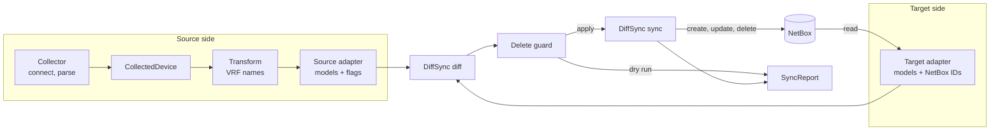

# Plan: Ingest Framework

- Status: Draft
- Date: 2026-11-10
- Decision: [0002. DiffSync For Reconciliation](../decisions/0002-diffsync-for-reconciliation.md)
- Prototype: [packages/\_ingest](../../packages/_ingest/)

## Goal

One way to write a feature that makes system B match system A. The first feature is the device import of the old project: serial, interfaces, IP addresses and MAC addresses from a network device to NetBox.

The old project has its own reconciler. This plan replaces it with DiffSync and keeps the domain rules.

## Old Design

Source: `devnet_/_legacy/src/netbox_pipelines` and `network_shared`.

```text
flow: NetBox devices (Redis claim) -> one task for each device
  extract    pyATS session, Genie parsers          -> CollectedDevice
  sync       reconcile(interfaces)                 -> NetBox IDs of the interfaces
             reconcile(IP addresses)               needs the interface IDs
             reconcile(MAC addresses)              needs the interface IDs
             _link_primary_macs, _link_parents     needs all IDs
  report     SyncSummary for each device -> SyncRun -> mail
```

### Keep

- `Collected*` models between the vendor parsers and the NetBox logic
- Plan, then guard, then apply. The delete guard blocks a mass delete after a bad collection
- One run for each device. A failure stays in that device
- The import rules: `sync_enabled` custom field, `ip_only`, "a down interface is not created"
- `VrfResolver`, the type rules in `_resolve_type`, the Redis claim for device batches

### Problems

| Problem                                                                                             | Effect                                                                                                              |
| --------------------------------------------------------------------------------------------------- | ------------------------------------------------------------------------------------------------------------------- |
| Models pair by NetBox ID. A child model needs the ID of its parent                                  | Three reconcile passes in a fixed order. IP and MAC models exist only after the interfaces are written              |
| Relations are set after the reconcile, in `_link_parents`, `_link_primary_macs`, `_link_primary_ip` | Four functions with their own compare, write and error code. Plan, guard and dry run do not see them                |
| One model does three jobs: data, NetBox payload, live pynetbox record                               | `from_record`, `to_payload`, `bind`, `require_record` on each model. Policy inputs (`is_up`, `has_ipv4`) are fields |
| Device code and VM code are copies                                                                  | `_ip_models` and `_vm_ip_models`, `_mac_models` and `_vm_mac_models`, `_link_primary_macs` two times                |
| pynetbox and pyATS are blocking                                                                     | They run in `async` tasks and block the event loop. ADR 0001 removes pynetbox                                       |
| The engine is devnet code                                                                           | 428 lines in `sync/common.py` to maintain and to explain                                                            |
| Three flows repeat the fan-out, the report and the failure code                                     | A new import starts as a copy of a flow                                                                             |

Defects found in the old code. The port must not copy them:

- `sync_device_interfaces` returns before the reconcile if `dry_run` is set. A dry run reports nothing
- The identity of a MAC address is its value. Interfaces that share a MAC address (SVIs) overwrite each other in the plan
- The same IP address on two interfaces raises `ValueError` and stops the whole device
- `VmPolicy.block_create` is never called. `transform_vms` keeps the first 10 VMs only
- The pyATS session changes the device config at each connect and writes a session log with the command output to `/tmp`. See the defects in the [compliance plan](compliance-framework.md#problems)

## New Design



### Parts

| Part           | Code                                         | Responsible for                                                           |
| -------------- | -------------------------------------------- | ------------------------------------------------------------------------- |
| Contract model | `DiffSyncModel` subclass, used by both sides | Which fields identify an object, which fields devnet owns, which children |
| Source adapter | `SyncAdapter`                                | `aload()`: build the models from collected data. Set the import rules     |
| Target adapter | `SyncAdapter` with `RemoteModel` models      | `aload()`: build the models from the system. Write one object             |
| Runner         | `run_sync()`                                 | Load, diff, delete guard, apply, report. The same for each feature        |
| Job            | One function, e.g. `import_device()`         | Build the two adapters, call the runner                                   |
| Flow           | devnet-flows                                 | Inventory, one task for each device, retries, mail                        |

DiffSync gives the models, the diff, the order of the writes and the flags. The framework (`ingest.sync`, 250 lines) adds async I/O, the dry run, the delete guard and the report.

### Model Tree

```text
device                  name                              | serial
└── interface           device, name                      | type, enabled, description, mtu, parent
    ├── ip_address      device, interface, address, vrf   | status, description
    └── mac_address     device, interface, mac            | primary
                        identifiers                       | attributes
```

### Rules

1. **Identifiers are names, not IDs.** Device name, interface name, address, VRF name. The source builds the whole tree before NetBox has the objects. One diff then has all changes, and a dry run shows them
2. **The target adapter keeps the IDs.** A NetBox model has a `pk` field that is not an attribute. A model resolves a name to an ID when it writes: `self.nb.interface_id(name)`
3. **A relation is an attribute.** `Interface.parent` is the name of the parent. `MACAddress.primary` sets the primary MAC address of the interface. No link functions after the sync
4. **An attribute is a field that devnet owns.** DiffSync compares attributes only. A value that devnet sets one time, such as the IP role `loopback`, is not an attribute. The target model sets it in `acreate`
5. **An import rule is a flag.** The adapter that knows the rule sets it at load. DiffSync applies a flag to the object and to its children

   | Rule                                            | Flag                            | Set by         |
   | ----------------------------------------------- | ------------------------------- | -------------- |
   | Interface has `sync_enabled: false` in NetBox   | `IGNORE`                        | Target adapter |
   | `ip_only` and the interface has no IPv4 address | `IGNORE`                        | Source adapter |
   | Interface is down and not in NetBox             | `SKIP_UNMATCHED_SRC`: no create | Source adapter |
   | Delete the addresses before their interface     | `NATURAL_DELETION_ORDER`        | Target adapter |

6. **The order of the writes is in a `Diff` subclass.** `DeviceDiff` creates a parent interface before its subinterfaces and deletes it after them
7. **One run is one scope.** A device import run has one device on each side. Runs for different devices are independent
8. **A collector returns complete data or raises.** The sync reads a missing interface as a removed interface

### Safety

- `dry_run` is `True` by default. The report has the same diff as a real run
- Delete guard: if the deletes are more than 50% of the target's objects, or the source is empty, the run applies no deletes and adds a warning. Creates and updates continue
- One failed object does not stop the run. Its children are skipped. The report has one line for each failure
- A cancelled run stops before its next write

### Async

DiffSync is blocking code and the clients are async. The framework connects them in one place:

- `SyncAdapter.aload()` is async. DiffSync never calls a load method itself
- The diff uses memory only. It runs on the event loop
- `run_sync()` runs the DiffSync sync in a worker thread. `RemoteModel` sends each write back to the event loop, where the HTTP client lives
- A feature writes `async def acreate / aupdate / adelete` and does not see the thread

### Report

`SyncReport` has `planned` and `applied` counts, `failures`, `warnings` and the diff as text. Example of a dry run:

```text
device
  device: sw1
    serial    device sw1(FOC123)    netbox()
    interface
      interface: GigabitEthernet0/1 MISSING in netbox
        ip_address
          ip_address: 10.0.0.1/24 MISSING in netbox
        mac_address
          mac_address: AA:BB:CC:00:01:00 MISSING in netbox
      interface: Loopback0 MISSING in netbox
        ip_address
          ip_address: 192.0.2.1/32 MISSING in netbox
DRY-RUN device sw1 -> netbox: create=5 update=1 delete=0 failed=0 warnings=0
```

## Old To New

| Old                                           | New                                                                         |
| --------------------------------------------- | --------------------------------------------------------------------------- |
| `NetboxModel.identity()`                      | `_identifiers`, with names                                                  |
| `managed_fields`, `diff_models()`             | `_attributes`, DiffSync diff                                                |
| `plan_change()`, `Plan`                       | `target.diff_from(source)`                                                  |
| `apply_change()`                              | DiffSync sync, which calls the `RemoteModel` hooks                          |
| `to_payload()`                                | `acreate` / `aupdate` of the NetBox model, with the generated request types |
| `from_record()`, `bind()`, `_record`          | `NetboxDeviceAdapter.aload()`, `pk` field                                   |
| `ReconcileResult.synced`                      | Not needed. The adapter store resolves names to IDs                         |
| `Policy.unmanaged()`, `Policy.skip()`         | Model flags, see rule 5                                                     |
| `DeleteGuard`                                 | `run_sync(max_delete_fraction=...)`, `SyncAdapter.empty`                    |
| `_link_parents()`                             | `Interface.parent` and `DeviceDiff`                                         |
| `_link_primary_macs()`                        | `MACAddress.primary`                                                        |
| `_link_primary_ip()` (VM)                     | `primary` attribute on the IP address of the VM feature                     |
| `SyncSummary`, `SyncReporter`                 | `SyncReport`. DiffSync logs each change                                     |
| `SyncRun.to_markdown()`                       | devnet-flows builds the mail from the reports                               |
| `sync_device_facts()` and its flow            | `Device.serial`, in the same run as the interfaces                          |
| `CollectedDevice`, `CollectedDeviceInterface` | `ingest.device.collected`                                                   |
| `_resolve_type()`                             | `ingest.device.interface_type`                                              |
| `VrfResolver`                                 | Transform step before the source adapter. Not ported yet                    |
| pynetbox                                      | `system_netbox` client                                                      |
| pyATS session                                 | `DeviceCli` port and `PyatsCli`, see the compliance plan                    |
| Genie parsers                                 | Collector. Not ported yet, see the open questions                           |
| `device_chunk_generator` (Redis claim)        | No change. It moves to devnet-flows                                         |

## Package Layout

| Path                                      | Contents                                                                                   |
| ----------------------------------------- | ------------------------------------------------------------------------------------------ |
| `packages/devnet-core` `devnet_core.sync` | The framework: `SyncAdapter`, `RemoteModel`, `run_sync`, `SyncReport`. No system knowledge |
| `packages/system-netbox`                  | NetBox client. New endpoint groups `client.dcim` and `client.ipam`                         |
| `packages/system-devices` (new)           | The `DeviceCli` port and its driver adapters, shared with compliance. Collector: parsers   |
| `packages/ingest`                         | Features that write to NetBox. One folder for each: `device/`, `virtual_machine/`          |
| `services/devnet-flows`                   | One flow for each feature                                                                  |

Import layers, top to bottom:

```text
devnet_api | devnet_flows
devnet_config
ingest | compliance
system_netbox | system_ise | system_devices
devnet_core
```

The prototype keeps all new code in `packages/_ingest`, so no active package changes.

## Add A Feature

1. Write the contract models. Identifiers are names that both systems know. Attributes are the fields that devnet owns
2. Write the source adapter: `aload()` builds the models. Set a flag for each object that a rule excludes
3. Write the target adapter: `aload()`, and a `RemoteModel` subclass for each model with `acreate`, `aupdate`, `adelete`. Reuse the NetBox models if the target is NetBox
4. Write the job: build the two adapters and call `run_sync()`
5. Test with a fake target. The minimum: the first run creates, the second run changes nothing
6. Add the flow and its deployment

The smallest complete feature is at the top of [test_sync_runner.py](../../packages/_ingest/tests/test_sync_runner.py): one model and two adapters in 50 lines.

## Prototype

| File                         | Contents                                                                      |
| ---------------------------- | ----------------------------------------------------------------------------- |
| `ingest/sync/adapter.py`     | `SyncAdapter`, `RemoteModel`: async load, async writes from the worker thread |
| `ingest/sync/runner.py`      | `run_sync()`: load, diff, delete guard, apply                                 |
| `ingest/sync/report.py`      | `SyncReport`                                                                  |
| `ingest/sync/logging.py`     | structlog to the `devnet.diffsync` logger                                     |
| `ingest/device/models.py`    | Contract models and `DeviceDiff`                                              |
| `ingest/device/collected.py` | `CollectedDevice`, `CollectedInterface`                                       |
| `ingest/device/source.py`    | `CollectedDeviceAdapter`: models and import rules                             |
| `ingest/device/netbox.py`    | `NetboxDeviceAdapter` and the NetBox models                                   |
| `ingest/device/job.py`       | `import_device()`                                                             |
| `tests/fake_netbox.py`       | NetBox REST API in memory, behind the real `NetboxClient`                     |

```bash
uv run --package ingest pytest packages/_ingest/tests
```

Limits of the prototype:

- The tests use a fake NetBox. No run against a real NetBox or a real device yet
- No collector and no VRF transform. The tests build `CollectedDevice` by hand
- An IP address that moves to a different interface of the same device is a delete and a create. The old code updated it. If NetBox enforces unique addresses and the create comes first, the create fails and the next run corrects it
- The NetBox adapter reads with `?fields=` into small models of its own, not into the generated types. Writes use the generated request types

## Steps

1. Answer the open questions. Accept ADR 0002
2. Run `import_device()` against the dev NetBox with a hand-made `CollectedDevice`
3. Promote the prototype: rename `_ingest` to `ingest`, move `ingest.sync` to `devnet_core.sync`, move the endpoints to `system_netbox`, add `ingest` to import-linter and deptry
4. Collector: run the commands with the `DeviceCli` port, parse to `CollectedDevice`. Port `_normalise_interfaces` and `_normalise_device_facts`
5. Transform: port `VrfResolver` with the alias and subnet rules of the `sync_vrf` custom field
6. Flow `ingest-devices`: inventory, Redis claim, one task for each device, mail from the reports
7. VM import from NSX: contract `virtual_machine` → `vm_interface` → addresses. Reuse the NetBox address models. Move `VmTransformConfig` from a Prefect variable to `devnet.yaml`
8. NetBox to ISE with the same framework

## Open Questions

1. **Parsers.** The driver is behind the `DeviceCli` port of the [compliance plan](compliance-framework.md#ports-and-adapters): pyATS now, a different driver later. The parsers are a separate choice. Genie parses text that a different driver collected (`Device(os=...).parse(command, output=text)`), so the old normalise code can stay while `genie` stays installed. TextFSM (ntc-templates) removes pyATS fully, and the normalise code is written again
2. **One device run or two.** The old project has a facts flow and an interfaces flow. The plan has one run with both: one SSH session, one diff. Two schedules are possible with a second job that uses `Device` without children
3. **IP address that moves.** Accept delete and create, or add a move to the NetBox model: it keeps the NetBox object and its history
4. **Behavior kept from the old code.** Each run sets the guessed interface type (`other` if nothing matches) and the IP status `active`. A value that a person sets in NetBox is lost. Remove `type` or `status` from the attributes to stop that
5. **Names.** `devnet_core.sync` for the framework and `system-devices` for the collector are proposals
