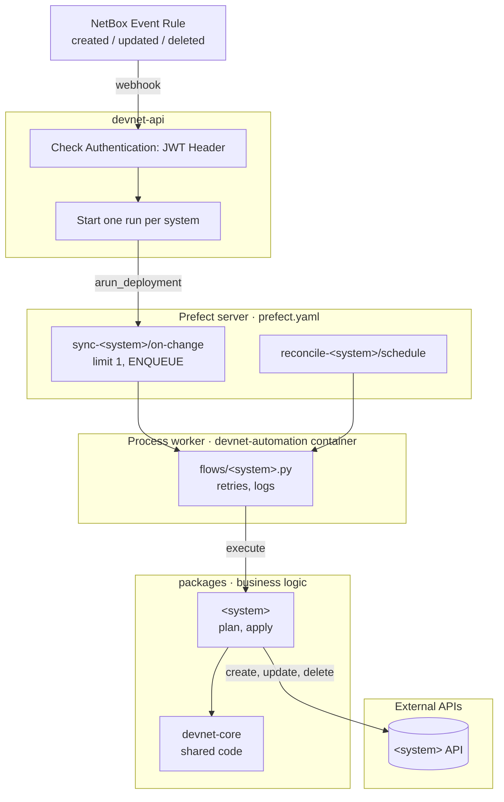

# Architecture

How a change in NetBox reaches the systems devnet keeps in sync with it

## Components



## Regenerate NetBox API types

```bash
# Regenerate NetBox API types after a NetBox upgrade (dev NetBox running)
cd packages/system-netbox
curl -fsS 'http://127.0.0.1:8080/api/schema/?format=yaml' -o schema/netbox.yaml
uv run datamodel-codegen
```
